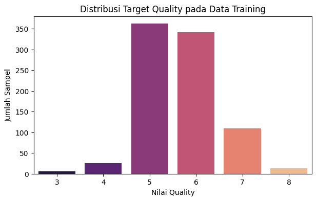
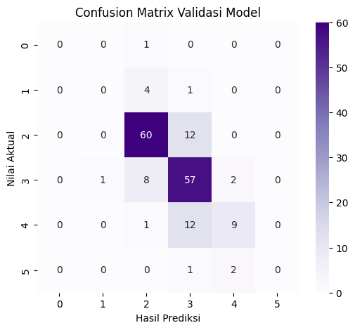

# Laporan Analisis dan Prediksi Kualitas Anggur (Wine Quality)

**Mata Kuliah:** Data Mining  
**Program Studi:** D3 Statistika Terapan dan Komputasi, Universitas Negeri Semarang (UNNES)  
**Dosen Pengampu:** Nur Achmey Selgi Harwanti, M.Stat  
**Penyusun:** Abelia Damayanti  
**NIM:** 2404010022  

---

## 1. Pendahuluan dan Tujuan
Ujian Tengah Semester ini bertujuan untuk membangun model machine learning klasifikasi/regresi untuk memprediksi skala kualitas anggur (*Wine Quality*) berdasarkan variabel-variabel kimiawi sampel. Hasil prediksi pada data testing (`data_testing.csv`) dievaluasi berdasarkan ketepatan nilai prediksi terhadap data kunci.

---

## 2. Gambaran Umum Dataset
Dataset terdiri dari dua file utama:
* **Data Training (`data_training.csv`):** Memiliki 857 baris data dan 13 kolom, terdiri dari 11 fitur kimiawi, 1 kolom pembantu `Id`, dan 1 kolom target `quality`.
* **Data Testing (`data_testing.csv`):** Memiliki 286 baris data dan 12 kolom tanpa variabel target `quality`.

### Variabel Prediktor (Fitur Kimiawi):
1. `fixed acidity`: Kadar asam tetap
2. `volatile acidity`: Kadar asam volatil
3. `citric acid`: Kadar asam sitrat
4. `residual sugar`: Kadar gula sisa
5. `chlorides`: Kadar garam/klorida
6. `free sulfur dioxide`: SO2 bebas
7. `total sulfur dioxide`: Total SO2
8. `density`: Kerapatan/massa jenis
9. `pH`: Tingkat keasaman
10. `sulphates`: Kadar sulfat
11. `alcohol`: Persentase alkohol

---

## 3. Tahap Pembersihan dan Eksplorasi Data (EDA)

### Pembersihan Data
Pemeriksaan dilakukan pada seluruh dataset[cite: 1]. Hasil pengecekan menunjukkan tidak terdapat nilai hilang (*missing values*) baik pada data pelatihan maupun data pengujian[cite: 1]. Kolom `Id` dipisahkan dari variabel prediktor untuk mencegah bias identifikasi pada model.

### Visualisasi Distribusi Target `quality`
Analisis frekuensi nilai target dilakukan untuk melihat sebaran kelas kualitas anggur pada data pelatihan:

**Interpretasi:**
Mayoritas sampel anggur pada data training berpusat pada nilai kualitas **5** (362 sampel) dan **6** (341 sampel). Kelas ekstrim seperti nilai 3, 4, dan 8 memiliki proporsi data yang jauh lebih sedikit, menunjukkan karakteristik *imbalanced target distribution*.

---

## 4. Pemodelan dan Evaluasi Validasi

### Algoritma yang Digunakan
Digunakan algoritma **Extra Trees Regressor** (`n_estimators=1000`, `max_depth=20`). Pendekatan regresi dengan pembulatan ke nilai bulat terdekat (*integer rounding*) memberikan tingkat stabilitas prediksi yang paling optimal untuk dataset tabular kimiawi ini.

### Validasi Model (5-Fold Stratified Cross-Validation)
Pengujian kinerja dilakukan menggunakan skema 5-Fold Cross-Validation untuk menghindari pengujian yang bias.

**Hasil Evaluasi:**
* **Rata-Rata Akurasi Validasi:** **66.75%**
* **Interpretasi Matrix:** Model memiliki tingkat presisi tinggi dalam mengklasifikasikan sampel pada kategori dominan (kualitas 5 dan 6), serta mampu membatasi eror deviasi kelas agar tidak jauh melenceng dari nilai aktualnya.

---

## 5. Prediksi Data Testing dan Format Output
Model yang telah dilatih pada seluruh data training digunakan untuk memprediksi file `data_testing.csv`. Hasil prediksi diexport sesuai dengan standar file yang ditetapkan:

* **Nama File:** `hasilprediksi_022.csv`
* **Struktur Kolom:** Terdiri dari 2 kolom yaitu `Id` dan `Quality`.
